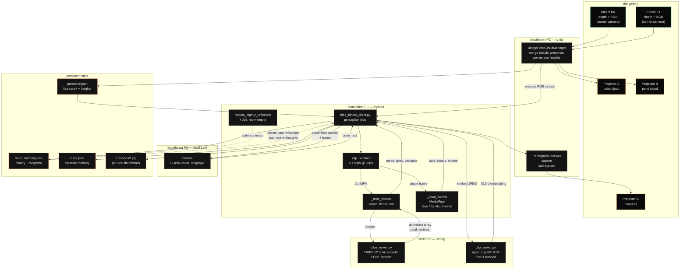

# Architecture — how the room thinks

Two diagrams of the same system. The Mermaid version renders in GitHub,
Obsidian, Notion, VS Code preview, and a handful of slide tools. The ASCII
version is for terminals, plaintext docs, and when nothing else will render.

---

## Mermaid



---

## ASCII

```
┌─ in the gallery ─────────────────────────────────────────────────┐
   Kinect K0  ──┐                              ┌──▶  Projector A   (cloud view)
                ├──▶  Unity bridge  ──merged──┤
   Kinect K1  ──┘     • point cloud           └──▶  Projector B   (cloud view)
                        • presence + heights
                        • RGB @ 8 fps                ──▶  Projector C   (caption)
                                │
└─ on the installation PC ──────┼──────────────────────────────────┘
                                ▼
                       tribe_kinect_client.py
                                │
                  ┌─────────────┼──────────────┬─────────────────┐
                  ▼             ▼              ▼                 ▼
            2 s RGB clip   single frame   single frame      presence.json
                  │             │              │
┌─ on the 3090 ──┼─────────────┼─────┐        │
   TRIBE v2  ◀───┘             │     │        ▼
   /predict                    │     │   MediaPipe  ──▶  face / hands /
   • activation                │     │   pose worker     motion / time
   • peak vertices             │     │
   /predict                    │     │
                               │     │
   CLIP server  ◀──────────────┘     │
   /embed                            │
   • 512-d ViT-B-32 vector ──┐       │
└────────────────────────────┼──────┘
                             │       │
                  ┌──────────┘       │
                  ▼                  ▼
            visits.json         Ollama / LLaVA
            + Episodes/         (local, vision+language)
                                       │
                                       ▼
                                  brain_text
                                       │
                                       ├──▶  Unity → Projector C
                                       ├──▶  room_memory.json
                                       └──▶  current_visit.thoughts

         At 4 AM, room empty:
            maybe_nightly_reflection()
            • summarise the last 24 h
            • self-critical: did the questions lead anywhere?
            • name one thing to do differently tomorrow
            • append to long-term memory; tomorrow's prompt will read it
```

---

## What each piece does

| component | what it does | runs where |
|---|---|---|
| **Kinect K0 / K1** | depth + RGB at 30 fps each; their feeds are merged into one point cloud in Unity | hardware |
| **Unity bridge** | point-cloud merging, depth post-processing (temporal smoothing, plate hole-fill), presence detection, presence.json writer | installation PC, Unity |
| **`tribe_kinect_client.py`** | the perception loop. Pulls frames, runs the four parallel workers, assembles the prompt, calls LLaVA, writes memory | installation PC, Python |
| **`_clip_producer`** | continuously captures 2 s RGB clips, keeps only the freshest in a maxsize-1 queue, exposes the middle frame to the pose worker | thread |
| **`_tribe_worker`** | async TRIBE call — never blocks the LLaVA loop | thread |
| **`_pose_worker`** | MediaPipe Face Mesh + Pose at ~2 Hz; classifies face orientation, hand position, motion, time elapsed | thread |
| **TRIBE v2 server** | brain-encoding model: predicts cortical activation from a 2 s video clip. Returns per-vertex activation; client averages to scalars | 3090 PC, Python |
| **CLIP server** | open_clip ViT-B-32 image embeddings — 512-d, unit length. Used for visit-to-visit recall | 3090 PC, Python |
| **Ollama / LLaVA** | vision + language model. Constructs the actual spoken thought from the assembled prompt + the current frame | installation PC, local |
| **`maybe_nightly_reflection`** | runs once a day at 4 AM with the room empty; summarises the day, names one thing to do differently | called from the perception loop |
| **`room_memory.json`** | every thought ever spoken (with TRIBE scalars), plus the day-by-day long-term reflections | persistentDataPath |
| **`visits.json`** | per-visit episodes: arrival, duration, peak people, CLIP signature, thoughts spoken during that visit, link to thumbnail | persistentDataPath |
| **`Episodes/`** | one 240×180 JPEG per visit, taken at the arrival moment | persistentDataPath |

---

## Hardware notes

- **Two Kinect v1 sensors** (older PrimeSense depth, 640×480 @ 30 fps).
  Mounted in opposing corners, ~3 m apart, angled inward + slightly down.
- **Installation PC** — runs Unity, the bridge, the perception loop,
  MediaPipe, and the local Ollama / LLaVA. CPU+GPU mid-range. No admin
  required on the strong PC.
- **3090 PC** — runs TRIBE v2 (`tribe_server.py`, port 8000) and the CLIP
  embedding server (`clip_server.py`, port 8001). Reachable over LAN at a
  a fixed address. No admin access from the installation side; both
  servers are user-space Python.
- **Three projectors** — daisy-chained as extended displays. Two show the
  point cloud (calibrated via the in-piece ProjectorCalibrator). The
  third shows the room's spoken thoughts on a black background with
  amber type, against a top-down view of the cloud.
- **Moog Theremini** — USB MIDI controller. CC20 (pitch) and CC2
  (volume) are read by `theremini_bridge.py`, smoothed, and sent over
  OSC to Unity, where they modulate the cloud's hue and shimmer.
